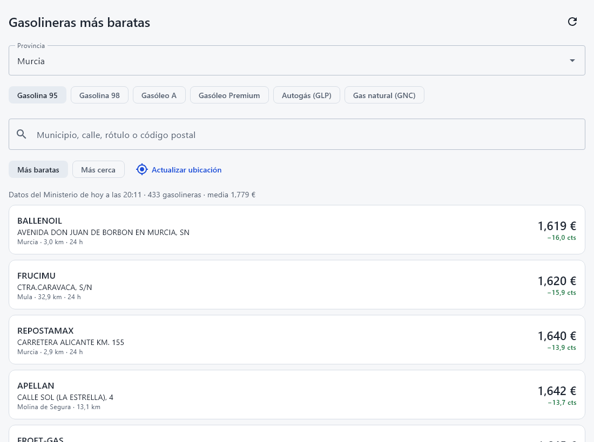
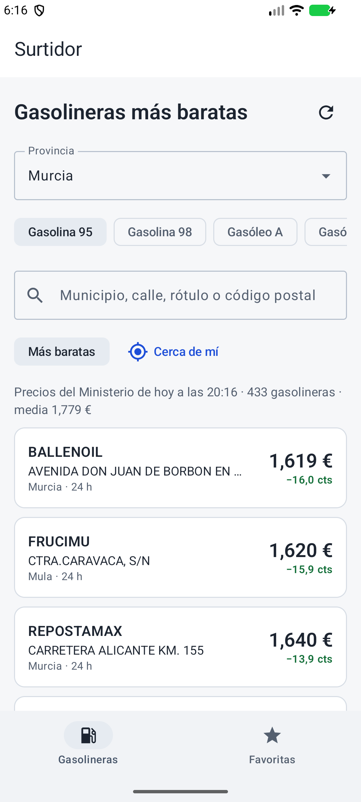
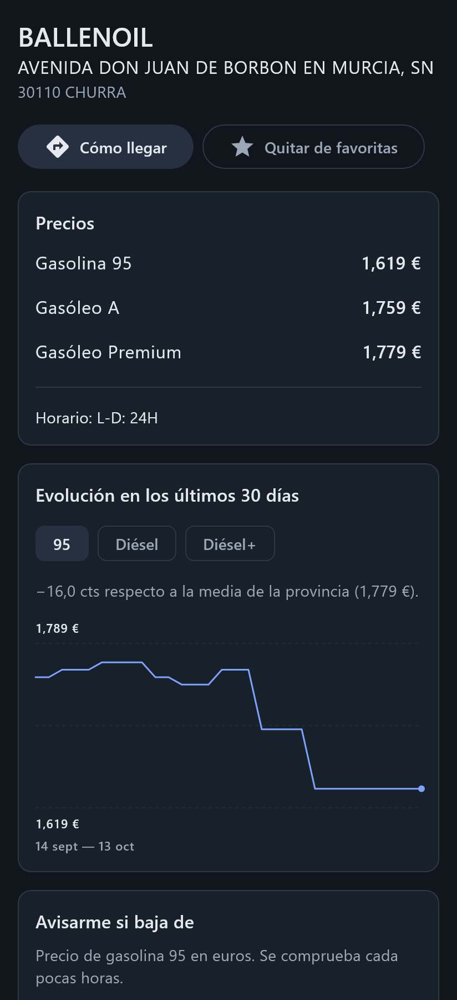

# Surtidor

App de **Android y escritorio** con los precios de los carburantes de las gasolineras de España: las más baratas
de tu provincia o de alrededor, la evolución de cada precio en los últimos 30 días y un aviso cuando una gasolinera
favorita baja del precio que tú fijas.

**Kotlin Multiplatform · Compose Multiplatform · Ktor · SQLDelight · Koin · coroutines y Flow**

Comparte entre plataformas el dominio, los datos, la lógica de presentación **y la interfaz**. Lo específico de cada
plataforma es poco: la ubicación, el driver de SQLite y, en Android, la tarea periódica de los avisos.

| Escritorio | Android (emulador) | Ficha en tema oscuro |
|---|---|---|
|  |  |  |

Todas las capturas son de datos reales del 13 de octubre de 2026. La de Android está hecha en un emulador con la
app descargando en vivo; las otras se generan pintando las pantallas con los precios de la provincia de Murcia de
ese día y sus 30 días anteriores (ver [Capturas](#capturas)).

## Qué hace

- **Lista** de las gasolineras de una provincia que venden el carburante elegido (gasolina 95 y 98, gasóleo A y
  Premium, GLP, GNC), de la más barata a la más cara o de la más cercana a la más lejana. Cada precio va con su
  diferencia en céntimos frente a la media de la provincia. Búsqueda por municipio, calle, rótulo o código postal,
  sin importar las tildes.
- **Ficha** de cada gasolinera: todos sus precios, horario, «Cómo llegar» y una gráfica de los últimos 30 días.
- **Favoritas** con aviso: si el precio baja de tu umbral, Android avisa con una notificación (cada seis horas, con
  conexión); en escritorio, al abrir la app.
- **Funciona sin conexión**: enseña lo último descargado, con la hora de esos datos.
- **Cerca de mí** en Android, con la ubicación del sistema (sin Google Play Services). El permiso se pide al pulsar
  el botón, nunca al arrancar.

## Los datos

API REST pública del Ministerio para la Transformación Digital y de la Función Pública (Geoportal de carburantes):
sin clave, actualizada varias veces al día.

- **Precios actuales** por provincia (Murcia: unas 470 gasolineras, medio megabyte).
- **Histórico**: los precios de un día pasado, por provincia.

La app solo pide lo que le falta. Los precios de hoy se vuelven a pedir si lo guardado tiene más de media hora. Del
histórico se piden los días que no estén guardados, de cuatro en cuatro, y se guardan para toda la provincia: la
segunda ficha ya no descarga nada.

El formato tiene sus trampas, y todas están probadas con respuestas reales grabadas:

- Números con coma decimal como texto (`"1,889"`) y vacíos (`""`) cuando la gasolinera no vende ese carburante.
- Claves con tildes y símbolos (`"Longitud (WGS84)"`) y una errata en la API (`"IDPovincia"`).
- JSON servido como `text/html`, fechas en hora peninsular sin zona y espacios repetidos en las direcciones.

## Arquitectura

```
shared/src/commonMain/kotlin/es/surtidor/
├── dominio/       Modelo y reglas puras: distancias, orden, resúmenes, cuándo avisar
├── datos/
│   ├── remoto/    Cliente Ktor del Geoportal, DTO y saneado
│   └── local/     SQLDelight (esquema en sqldelight/): gasolineras, precios por día, favoritas, ajustes
├── presentacion/  ViewModels multiplataforma con un StateFlow de estado inmutable
└── ui/            Pantallas Compose, tema claro y oscuro, gráfica, iconos
shared/src/androidMain y desktopMain   Driver SQLite, motor HTTP y ubicación (expect/actual)
androidApp/        Activity, WorkManager (avisos) y notificaciones
desktopApp/        Ventana de escritorio
```

- **La base local es la única fuente de verdad.** La interfaz observa la base con `Flow`, y la red solo la refresca.
  Así el modo sin conexión no es un caso especial.
- **Inyección con Koin**: un módulo común y uno por plataforma.
- **Navegación** con rutas tipadas de navigation-compose. En pantallas anchas (escritorio, tableta) la navegación va
  en un riel lateral; en el móvil, abajo.

Decisiones con sus alternativas en [docs/adr](docs/adr).

## Calidad

| | |
|---|---|
| Pruebas comunes | Mapeo con respuestas reales, reglas del dominio, cliente HTTP con `MockEngine` (rutas, reintentos, formatos rotos), repositorio con SQLite real en memoria (caché, sin conexión, histórico incremental), avisos y ViewModels. Se ejecutan **en JVM y en Android** |
| Pruebas de interfaz | Compose UI Test en escritorio: lista, búsqueda, errores, ficha, gráfica y aviso |
| Análisis | Kotlin con los avisos como errores, ktlint (Spotless) y Android Lint con los avisos como errores |

```bash
./gradlew spotlessCheck allTests :androidApp:lintDebug
```

Con eso pasan 44 pruebas en escritorio y 38 en Android.

## Ejecutarlo

Hace falta JDK 21 y, para Android, el SDK con la plataforma 37.

Escritorio:

```bash
./gradlew :desktopApp:run
```

Android (dispositivo o emulador conectado):

```bash
./gradlew :androidApp:installDebug
```

Instalador del sistema (MSI, DMG o DEB según el sistema):

```bash
./gradlew :desktopApp:packageDistributionForCurrentOS
```

iOS no está incluido: solo se puede compilar en un Mac. La estructura (todo en `commonMain`, lo de plataforma con
`expect/actual`) está preparada para añadirlo.

## Capturas

Se generan con una prueba que pinta las pantallas reales con datos reales:

```bash
./gradlew :shared:desktopTest -Pcapturas=<carpeta>
```

La carpeta tiene que contener `actual.json` (precios de una provincia) y `hist_dd-MM-aaaa.json` (sus días
anteriores), tal como los devuelve la API.

## Licencia

[MIT](LICENSE). Los iconos son de Material Icons (Google, licencia Apache 2.0). Los datos son del Ministerio para la
Transformación Digital y de la Función Pública.
